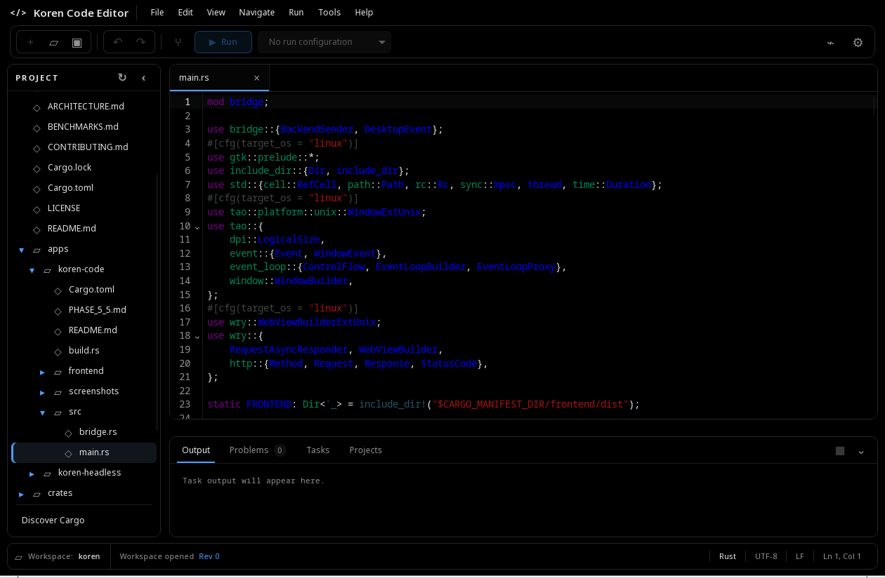
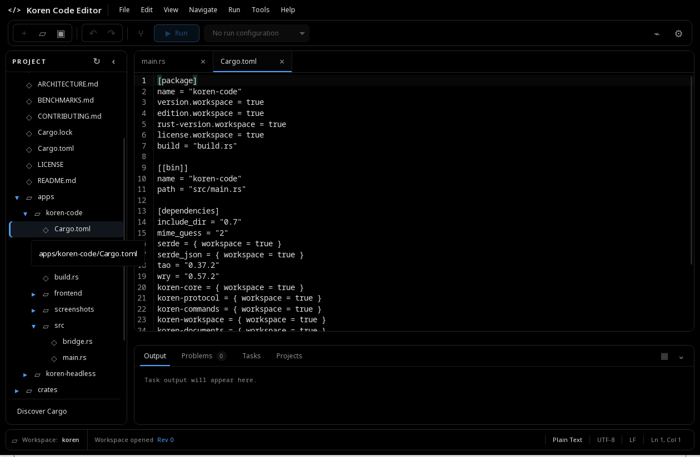
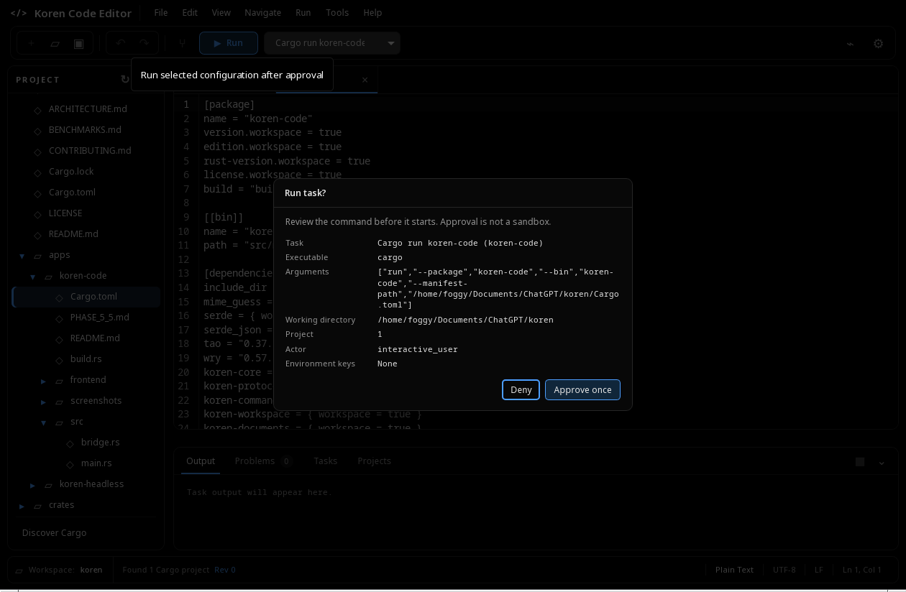

# OLED UI redesign

The Koren Code Editor workbench now follows the supplied OLED-black reference while keeping the existing Tao/Wry shell, CodeMirror editor, workspace services, typed IPC, and Cargo task approval flow.

## Interface changes

- Added compact File, Edit, View, Navigate, Run, Tools, and Help menus with a second action toolbar.
- Added a project panel with refresh, panel options, collapse, independent scrolling, and active-file styling.
- Framed the editor tabs and bottom tool panel with thin borders, restrained rounding, and blue active indicators.
- Kept the Output, Problems, Tasks, and existing Projects panel available.
- Added a compact workspace and document status strip across the bottom.
- Added an OLED-black default theme and retained the light theme.
- Connected toolbar save, undo, redo, workspace open, settings, and Cargo Run configuration controls to existing behavior. New File and Source Control remain disabled until those actions are available.

The UI stays language-neutral. The Cargo Run selector only displays discovered run tasks, and requesting one continues through the existing graphical execution approval.

## Visual captures

These captures show the running Linux desktop application with a workspace open, multiple documents, and the execution approval dialog.

The captures omit the Linux window-manager title bar; native decorations remain platform-managed.
