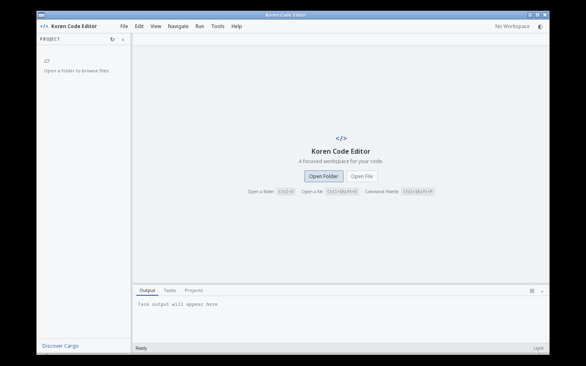
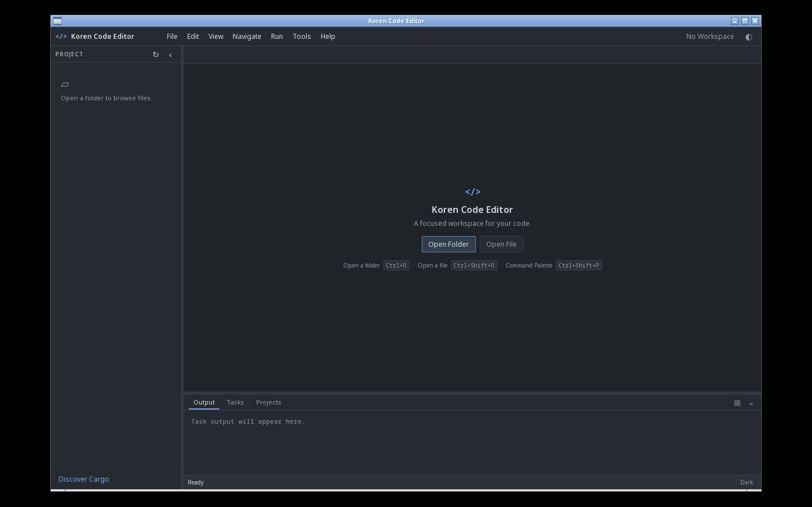
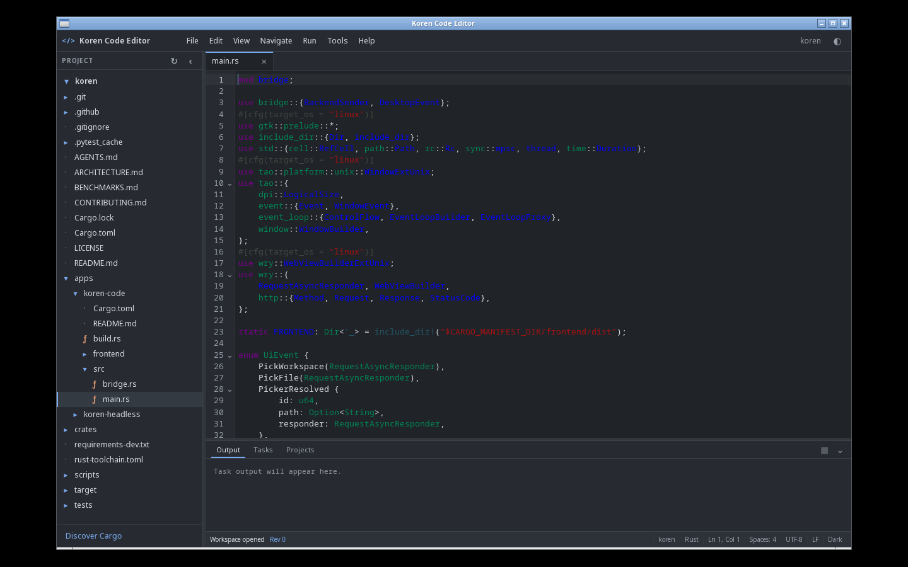
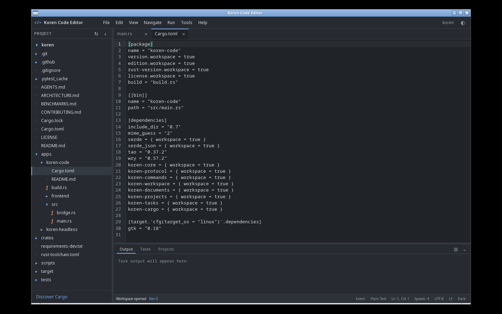
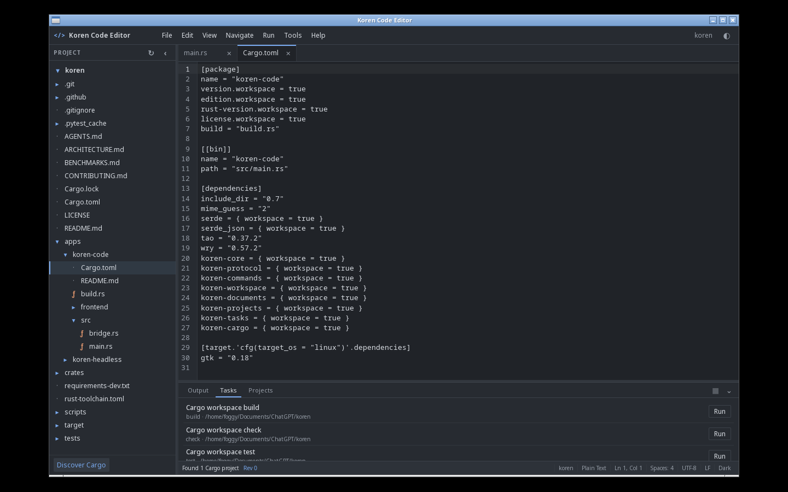
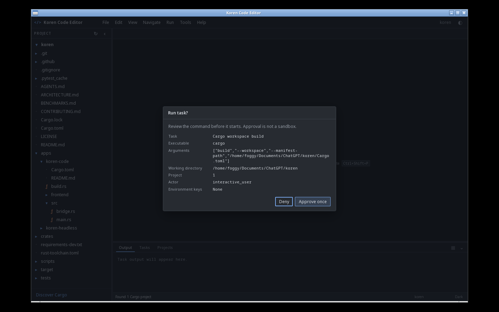

# Phase 5.5 UI refinement and desktop polish

Phase 5.5 refines the existing Koren Code Editor shell while keeping it a language-neutral application powered by Koren IDE Platform. The native Tao/Wry window, TypeScript frontend, CodeMirror editor, protocol v2, document revision flow, safe save, Cargo provider, and execution approval model remain in place.

The shell now has seven compact menus with working actions, a lazy collapsible explorer, distinct active and dirty tab states, a smaller resizable bottom panel, a compact status bar, a concise empty-workspace view, and shared dark/light theme tokens. Explorer width and bottom-panel height and collapse state persist in local storage. Rust syntax highlighting is loaded on demand, and Vite emits a separate Rust language chunk without the prior oversized-chunk warning. The command palette lists and invokes commands from the existing Rust `CommandRegistry`; the built-in `core.ping` command proves the connection, and future registered commands can appear without a TypeScript command engine.

Interactive desktop verification exposed two issues that prevented ordinary use: WebKit's custom URL handler supplied an empty body for POST bridge calls, and directory entries had no state node for the explorer to expand. Typed platform requests now use Wry's IPC handler and return through correlated response events; static assets, long-poll events, and native pickers remain on the custom protocol. The explorer creates child state as it receives each directory listing, preserving lazy enumeration. Regression tests cover request correlation over IPC and directory expansion.

## Screenshots

These are captures of the running Linux desktop application at 1440×900 Xvfb display resolution (1260×820 application window). Screenshots were visually inspected for layout, readability, clipping, and spacing.

Interactive acceptance opened the repository as a workspace, expanded nested directories, opened `apps/koren-code/src/main.rs` and `apps/koren-code/Cargo.toml`, switched the active tab, discovered a Cargo workspace, displayed the task panel, and opened the approval dialog for the Cargo workspace build. The build was not approved during screenshot capture. The empty workspace was also resized and inspected at 760×520 and the 680×440 minimum window size. The smaller layout hid the brand text at narrow width and wrapped the keyboard hint without clipping.

## Performance

The Linux desktop smoke script was run three times serially after the final debug build. It detects the visible window and samples the app process tree's RSS one second later. Results were 170.3, 170.9, and 167.8 ms to the visible window; and 373,484, 373,664, and 373,592 KiB RSS. The medians are 170.3 ms and 373,592 KiB.

The Phase 5 single-run baseline was 170.2 ms and 373,204 KiB. Against that one-run baseline, the Phase 5.5 median is 0.1 ms slower and 388 KiB higher in process-tree RSS (about 0.1%). These small differences are within normal run-to-run noise; they do not establish a performance change. Both samples use Linux with Xvfb and Openbox. The measurements are diagnostic, not production hardware claims.

The production frontend build is 432.15 kB raw for its main JavaScript chunk (138.32 kB gzip), plus a 110.06 kB Rust language chunk (39.45 kB gzip). Vite completes without the prior chunk-size warning.

## Verification

Frontend typecheck, lint, unit tests, and production build passed. The frontend suite has 18 tests. Rust formatting, workspace Clippy with warnings denied, all workspace tests and doc tests, architecture checks, the Python suite (20 tests), headless build, clean workspace build, and release build passed. The `koren-code` Rust suite has 4 tests.

The final desktop-smoke invocation inside `scripts/pr_check.py` failed because `xvfb-run -a` selected display `:109`, where GTK could not initialize. Running that same smoke script with an explicit Xvfb display (`xvfb-run -n 177 python3 scripts/desktop_smoke.py target/debug/koren-code`) passed and reported 171.6 ms startup and 373,944 KiB process-tree RSS. This is an environment-specific limitation of automatic X display selection; the desktop was also launched and interactively inspected on explicit Xvfb displays.

Windows and macOS native UI behavior was not visually verified in this phase.
